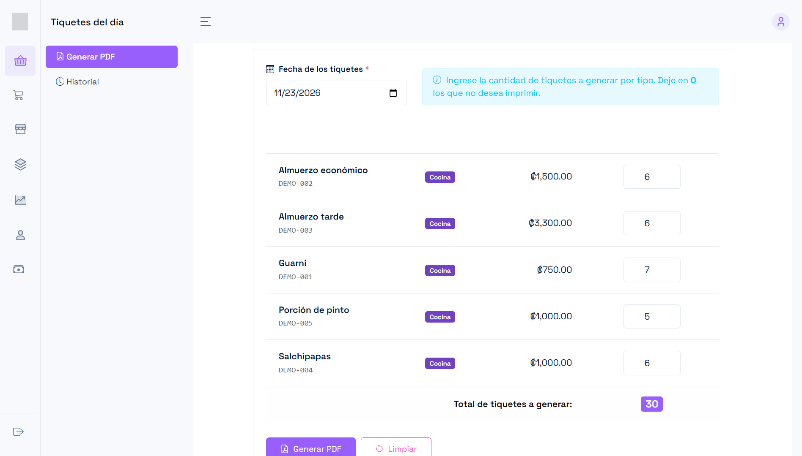
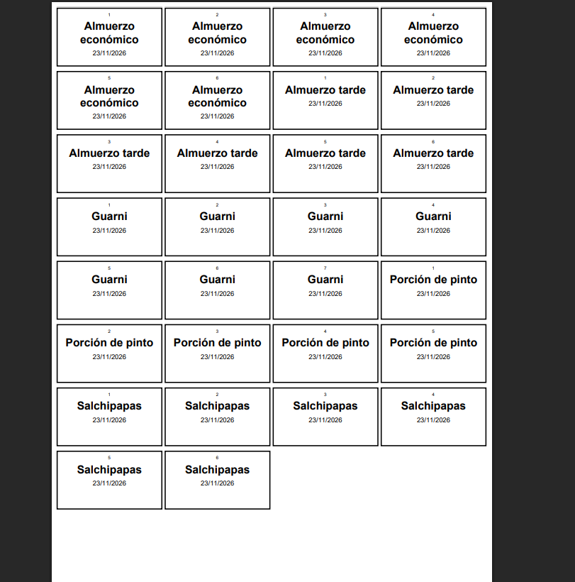

# Sistema de gestión de soda escolar

Aplicación web desarrollada con Laravel para apoyar la gestión de una soda escolar (ESCUELA TECNICA AGRICOLA E INDUSTRIAL) mediante diferentes módulos administrativos.

## Mi contribución al proyecto

Mi participación estuvo enfocada en el desarrollo del **módulo de generación de tiquetes**, diseñado para facilitar la emisión de tiquetes correspondientes a los productos de cocina.

### Funcionalidades del módulo

- Consulta de productos de la categoría Cocina.
- Selección de la fecha del servicio.
- Registro de cantidades por producto.
- Generación de tiquetes en formato PDF.
- Numeración consecutiva de tiquetes por producto y fecha.
- Generación de códigos de barras mediante Code 128.
- Registro de generaciones para su seguimiento.

## Capturas de pantalla

### Formulario de generación de tiquetes



### Documento PDF generado



## Tecnologías utilizadas

- PHP
- Laravel 12
- JavaScript
- HTML5
- CSS3
- SQLite / MySQL
- Composer
- NPM

## Instalación y ejecución

### Requisitos

- PHP
- Composer
- Node.js y NPM
- Base de datos configurada

### Procedimiento

1. Clonar el repositorio:

   ```bash
   git clone URL_DEL_REPOSITORIO
   ```

2. Entrar al proyecto:

   ```bash
   cd soda
   ```

3. Instalar dependencias:

   ```bash
   composer install
   npm install
   ```

4. Configurar el archivo `.env` con los datos de conexión a la base de datos.

5. Generar la clave de aplicación:

   ```bash
   php artisan key:generate
   ```

6. Ejecutar las migraciones:

   ```bash
   php artisan migrate
   ```

7. Compilar los recursos:

   ```bash
   npm run build
   ```

8. Iniciar el servidor:

   ```bash
   php artisan serve
   ```

La aplicación estará disponible en:

`http://127.0.0.1:8000`

## Alcance de mi participación

Este proyecto fue desarrollado en equipo. Mi aporte se concentró en el módulo de generación de tiquetes; los demás módulos corresponden al trabajo de otros integrantes.

## Autor

**Osvaldo Daniel Salazar Oporta**

- GitHub: https://github.com/osvaldo-salazar
- LinkedIn: https://www.linkedin.com/in/osvaldo-salazar-517a87370/
